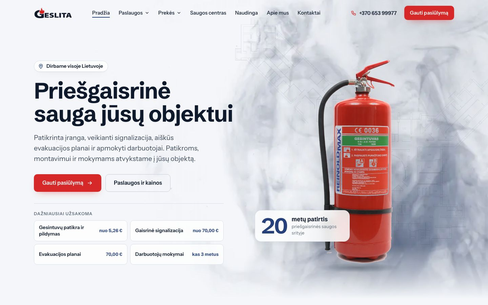
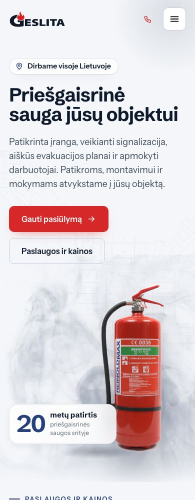
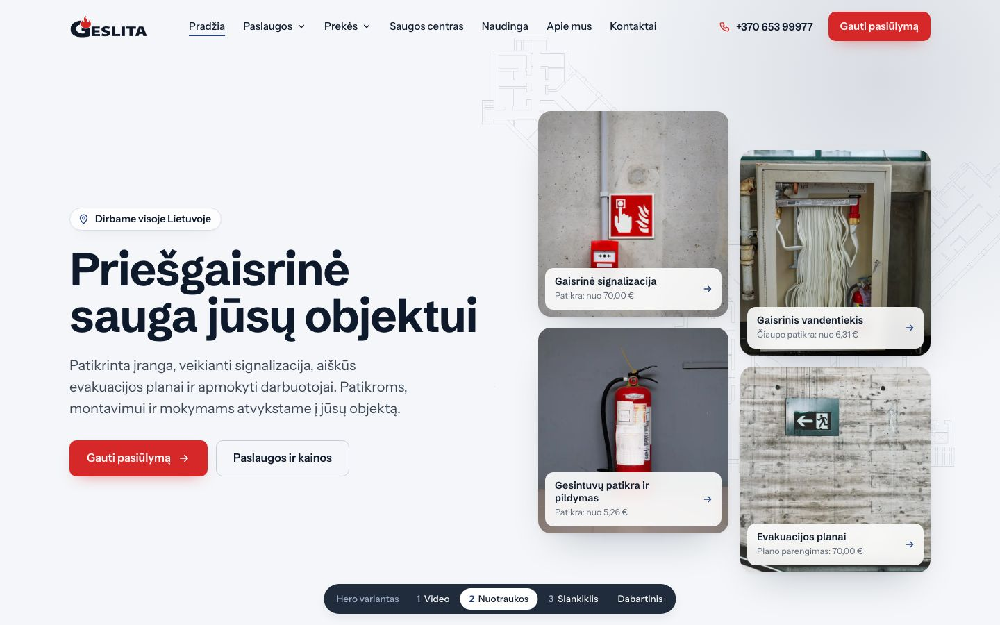
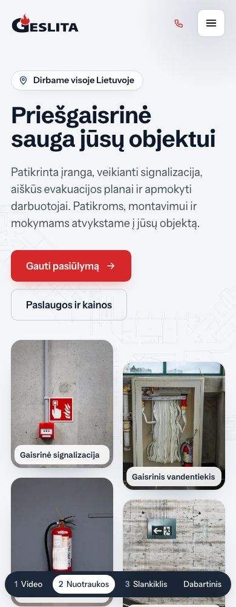
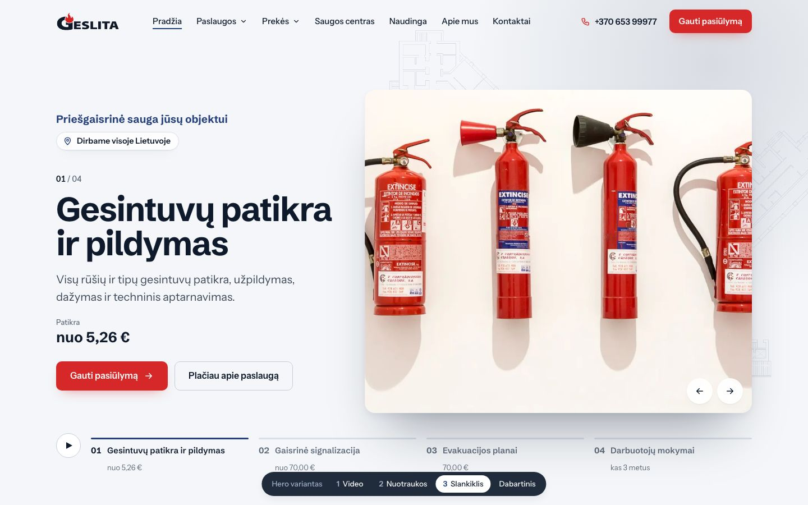
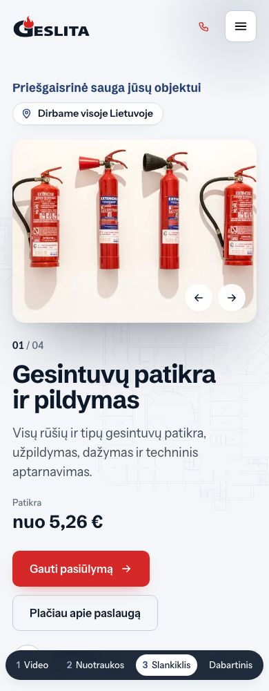

# Pradžios puslapio hero: trys variantai

> **Pasirinktas 1 variantas (Video), 2026-11-04.** Jis dabar yra pradžios puslapis `index.html` ir papildytas kortele „20 metų patirtis“, o „Dažniausiai užsakoma“ nuorodos vėliau pašalintos. 2 ir 3 variantai palikti palyginimui (`hero-2-nuotraukos.html`, `hero-3-slankiklis.html`), jų perjungiklio mygtukas „1 Video“ veda į `index.html`. Ankstesnis trijų nuotraukų steko hero nebegeneruojamas, jo šablonas liko `templates/_hero_base.html`.

Klientui palyginti paruošti trys hero variantai. Visas likęs pradžios puslapis yra vienodas, keičiasi tik pirmas ekranas. 2 ir 3 variantų apačioje yra tamsus perjungiklis „Hero variantas“, kuriuo galima pereiti tarp variantų. Perjungiklis skirtas tik demonstracijai.

Peržiūra: paleisti `python3 serve.py` ir atidaryti puslapius.

| Variantas | Puslapis | Esmė |
|---|---|---|
| 1. Video (pasirinktas) | `index.html` | Dūmų video per visą hero, jame tikras Geslitos gesintuvas ir kortelė „20 metų patirtis“ |
| 2. Naujos nuotraukos | `hero-2-nuotraukos.html` | Keturių paslaugų nuotraukų mozaika: kiekviena nuotrauka yra nuoroda į paslaugą su kaina, stulpeliai slenka priešingomis kryptimis |
| 3. Slankiklis | `hero-3-slankiklis.html` | Keturios skaidrės, po vieną paslaugai: didelė antraštė, aprašymas, kaina, nuoroda; skirtukai su progreso juosta |
| Ankstesnis | nebegeneruojamas | Trijų nuotraukų stekas su švelniais dūmais tarp sluoksnių |

Visuose variantuose yra ženklelis „Dirbame visoje Lietuvoje“, tie patys mygtukai ir ta pati H1 antraštė, todėl palyginimas vyksta tik pagal vizualą ir struktūrą.

## 1. Video

**Kas yra:**
- Tamsiai mėlyni dūmai kyla per visą dešinę hero pusę ir išblunka link teksto.
- Dūmuose stovi tikras Geslitos parduodamas gesintuvas su lietuvišku užrašu, išpjautas iš Geslitos katalogo nuotraukos. Jis lėtai „plūduriuoja“ ir seka pelę.
- Po mygtukais yra keturios greitosios nuorodos su kainomis: gesintuvų patikra, signalizacija, evakuacijos planai, mokymai. Telefone jos paslėptos, nes iškart po hero eina paslaugų kortelės.

**Stiprybės:** stipriausias pirmas įspūdis, rodomas tikras produktas, o ne nuotrauka iš banko. Dūmai iškart pasako, kuo užsiima įmonė.

**Į ką atkreipti dėmesį:** tai sunkiausias variantas, nes video sveria 1,4 MB kompiuteryje ir 0,26 MB telefone. Gesintuvo išpjova yra 560 x 1062 px, tad didelėse raiškose norėtųsi geresnės kokybės produkto nuotraukos.

**Salient:**
- Eilutė: Full Height Row, Background Video (MP4) su Video Preview Image `dumai-poster.webp`.
- Video turi baltą foną. Jei hero eilutės fonas yra baltas, dūmai įsilieja be jokio papildomo CSS. Jei fonas lieka `#F4F6F9`, video reikia perkoduoti su tokiu pačiu fonu arba pridėti `mix-blend-mode: multiply`.
- Gesintuvas: Image su Shadow Method: CSS Filter Drop Shadow, Movement Choice: Move Y Axis, Movement Intensity 1–2.
- Mouse Based Parallax Scene nenaudoti, nes kol ji įjungta, Salient išjungia fono video.
- Greitosios nuorodos: Inner Row su 2 kolonomis ir mygtukais arba Icon List.

## 2. Naujos nuotraukos

**Kas yra:**
- Keturios naujos Pexels nuotraukos vienoje šaltų pilkų tonų gamoje: gaisro pavojaus mygtukas, gesintuvas, gaisrinė spinta ir evakuacijos ženklas. Ženklai europietiški, su piktogramomis, kokios naudojamos Lietuvoje.
- Kiekviena nuotrauka yra nuoroda į paslaugą su kaina, todėl hero kartu atlieka ir navigacijos darbą.
- Du stulpeliai slenka priešingomis kryptimis ir sukuria gylį be video.

**Stiprybės:** informatyviausias variantas. Lankytojas iš karto mato keturias pagrindines paslaugas ir kainas. Jis lengvesnis už video, o nuotraukas lengva pakeisti tikromis Geslitos objektų nuotraukomis.

**Į ką atkreipti dėmesį:** nuotraukos yra iš banko. Geriausias rezultatas būtų su keturiomis tikromis Geslitos darbų nuotraukomis tame pačiame stiliuje: šviesi siena, vienas raudonas objektas, rami kompozicija.

**Salient:**
- Eilutė 1/2 + 1/2. Dešinėje Inner Row su 2 kolonomis, kiekvienoje 2 plytelės.
- Plytelė: kolona su Background Image, Column Link ir Border Radius 18px. Užrašui naudojama vidinė eilutė su Background Color `#FFFFFFE6`, Backdrop Filter Blur ir Border Radius.
- Stulpelių judesys: Column Animation Type: Scroll Position Animation, Move Y Axis, intensyvumas +1,5 ir −1,5.

## 3. Slankiklis

**Kas yra:**
- Keturios skaidrės: gesintuvų patikra, gaisrinė signalizacija, evakuacijos planai ir darbuotojų mokymai. Kiekvienoje yra didelė antraštė, aprašymas, kaina ir mygtukai „Gauti pasiūlymą“ bei „Plačiau apie paslaugą“.
- Nuotrauka keičiasi „užuolaidos“ perėjimu ir lėtai priartėja.
- Apačioje yra keturi skirtukai su progreso juosta, rodyklės ir sustabdymo mygtukas. Telefone skaidres galima braukti.
- Slankiklis prieinamas: tai WAI-ARIA skirtukų karuselė. Automatinis slinkimas sustoja užvedus pelę ar fokusavus, veikia rodyklės klaviatūroje, o esant „mažiau judesio“ nustatymui skaidrės pačios nesislenka.

**Stiprybės:** kiekviena pagrindinė paslauga gauna visą pirmą ekraną ir savo kainą.

**Į ką atkreipti dėmesį:** 2–4 skaidres mato tik dalis lankytojų, nes dauguma nelaukia, kol skaidrė pasikeis. Salient demonstracijose slankikliai nenaudojami, o Salient Nectar Slider yra pažymėtas kaip pasenęs elementas.

**Salient:**
- Artimiausias natyvus sprendimas yra Carousel elementas (Flickity) su Autorotate ir rodyklėmis, arba Tabs su nuotrauka kiekviename skirtuke.
- Skirtukai su progreso juosta ir automatinis perjungimas Salient natyviai nėra. Jiems reikėtų apie 40 eilučių papildomo JS pradžios puslapyje (demo `main.js` yra paruoštas pavyzdys).
- Nectar Slider nenaudoti, nes jis pasenęs.

## Rekomendacija

Siūlome **1 variantą (Video)**: jis įgyvendina kliento prašymą dėl dūmų, rodo tikrą produktą ir yra natyviausiai perkeliamas į Salient. Jei klientui svarbiau iš karto parodyti paslaugas ir kainas, **2 variantas** yra informatyviausias ir lengviausias. Slankiklį siūlome tik tuo atveju, jei klientas būtinai nori kiekvienai paslaugai skirti pirmą ekraną.

Variantus galima ir derinti: pavyzdžiui, 1 variantas su 2 varianto nuotraukų nuorodomis vietoje greitųjų nuorodų.
